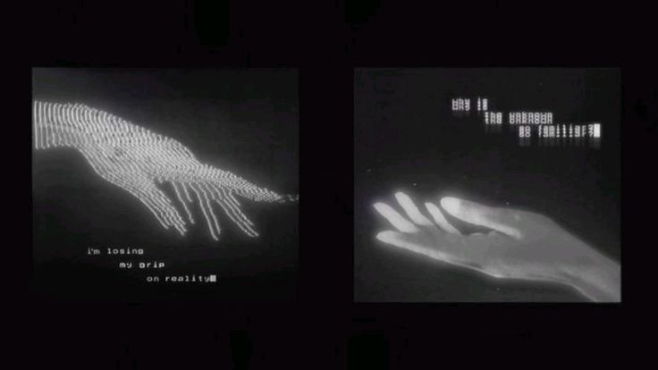
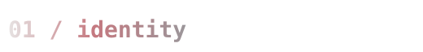
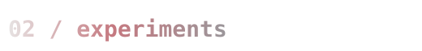
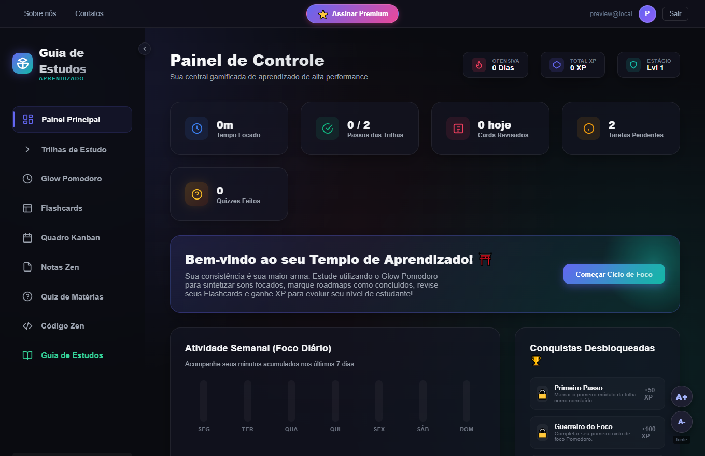
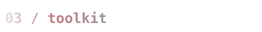
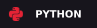
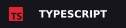
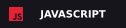
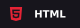
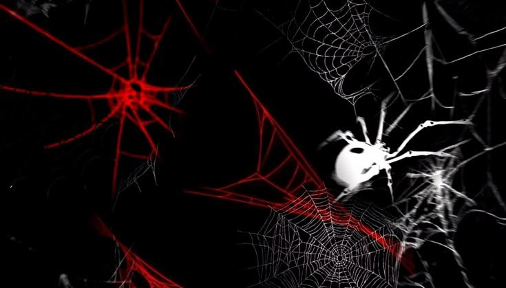



 

<picture>
  <source media="(prefers-color-scheme: dark)" srcset="assets/title-polished-dark.svg" />
  <source media="(prefers-color-scheme: light)" srcset="assets/title-polished-light.svg" />
  
</picture>

<code>software · ideas · experiments</code>

  <a href="https://hayaaitfx-ops.github.io/still-alive/">Still Alive ↗</a>
  &nbsp;·&nbsp;
  <a href="https://github.com/hayaaitfx-ops?tab=repositories">All repositories ↗</a>

> “The Word became flesh and dwelt among us.” — John 1:14

 

<picture>
  <source media="(prefers-color-scheme: dark)" srcset="assets/identity-polished-dark.svg" />
  <source media="(prefers-color-scheme: light)" srcset="assets/identity-polished-light.svg" />
  
</picture>

Sou **Knoten**, desenvolvedor independente. Gosto de transformar ideias em projetos funcionais — de experiências visuais na web a ferramentas criativas e experimentos com inteligência artificial.

Este perfil reúne coisas que estou construindo, aprendendo e refinando. Nem tudo está terminado; a ideia é justamente mostrar o processo.

 

<picture>
  <source media="(prefers-color-scheme: dark)" srcset="assets/experiments-polished-dark.svg" />
  <source media="(prefers-color-scheme: light)" srcset="assets/experiments-polished-light.svg" />
  
</picture>

### `01` — Still Alive
**Um zine digital sobre continuar, mesmo quando tudo parece ruído.**

Experiência visual construída com textura, tipografia e atmosfera própria. O projeto também inclui um site complementar de pôster.

- [Abrir Still Alive ↗](https://hayaaitfx-ops.github.io/still-alive/)
- [Explorar Poster Site ↗](https://hayaaitfx-ops.github.io/still-alive/poster-site/)
- [Ver código-fonte ↗](https://github.com/hayaaitfx-ops/still-alive)

`HTML · CSS · JavaScript`

---

### `02` — Nexo
**Um espaço visual para conectar ideias e organizar projetos.**

Mapa mental local com nós arrastáveis, conexões, notas, filtros, apresentação de ideias e backup em JSON. Sem conta ou servidor: os dados ficam no navegador.

- [Ver projeto ↗](https://github.com/hayaaitfx-ops/Nexo)

`JavaScript · HTML · CSS · IndexedDB`

---

### `03` — Aki
**Um experimento pessoal com inteligência artificial.**

Projeto em desenvolvimento, explorando possibilidades de criar uma experiência própria em torno de IA.

- [Ver projeto ↗](https://github.com/hayaaitfx-ops/Aki)

`TypeScript`

---

### `04` — Guia de Estudos
**Um pequeno portal para transformar estudo em rotina.**

Organização por trilhas, acompanhamento de progresso, Pomodoro e flashcards, com dados salvos localmente no navegador.

  
   
  <a href="https://github.com/hayaaitfx-ops/Site-guia-de-estudos">Ver projeto ↗</a>

`JavaScript · HTML · CSS · localStorage`

---

### `05` — Outros experimentos

- [Cartinha](https://github.com/hayaaitfx-ops/Cartinha) — um pequeno projeto pessoal para a web.
- [miku-text](https://github.com/hayaaitfx-ops/miku-text) — experimento em HTML.

 

<picture>
  <source media="(prefers-color-scheme: dark)" srcset="assets/toolkit-polished-dark.svg" />
  <source media="(prefers-color-scheme: light)" srcset="assets/toolkit-polished-light.svg" />
  
</picture>

  
  
  
  

 

 

<a href="https://github.com/hayaaitfx-ops?tab=repositories">explore os repositórios ↗</a>

**────── ⋆ ☾ ⋆ ──────**

<code>session ended. ideas still running_</code>

